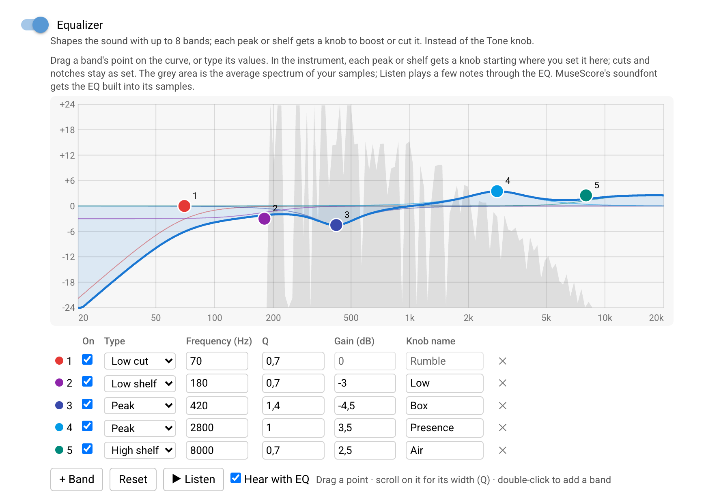

# DecentSampler Instrument Builder

Turn your own recordings of an instrument into a playable [DecentSampler](https://www.decentsamples.com/product/decent-sampler-plugin/) instrument. You describe the instrument, record each note in the app (or bring files from your DAW), check the samples, and the builder writes a ready-to-load `.dsbundle`.

It was made for ukuleles, but works for any plucked or struck string instrument, pitched percussion (kalimba, metallophone), sustained instruments, drums and single sounds.


## What it does

### Recording and organising takes

- **A recording plan from a description:** choose the type, the strings and their tuning (or a note range), the velocities and how many variations of each. The builder works out every take to record and names its files. Each note is recorded on the string where it's played at the lowest fret.
- **Record in the app** from your audio interface, with a count-in and a visual metronome. Dropouts from the interface are caught, so they don't end up as clicks in a sample. You can also drop in files from your DAW, or import a folder of samples that are already cut (the note comes from the file name or the measured pitch).
- **Several signals per note**, e.g. pickup and microphone, recorded together or in passes of their own. Signals recorded together are cut at the same points, so they stay in phase and can be blended, switched or layered.
- **Takes are cut into single hits automatically**, each sample starting exactly at the pluck. You can move a cut by hand, move a recording to the note it was really played on, or edit it in your audio editor: the builder picks up the change and keeps your decisions.
- **Extras:** release noises, chucks (down and up strokes on keys of their own, stopping the notes still ringing) and body knocks.

### Checking the recordings

- Each hit shows its tuning and attack loudness. Wrong notes, clipping, hits without a pitch, cut-off hits and hits whose loudness fits another velocity better are flagged.
- **An aim for each velocity** tells you how loud to play the soft ones, so each velocity sounds alike on every note.
- Uneven variations, velocities that don't get louder in order, and weak loops are reported too. A filter shows only the notes with problems.
- Play a row's hits one after another to compare them, then reject the weak ones, record replacements or move a hit to another velocity.


### Cleaning up noise

- **Denoising** (optional): spectral noise reduction that uses your noise-floor recording as the noise profile.
- **Clean-up EQ:** takes mains hum (50 or 60 Hz, with its harmonics), buzz or a click's ring out of the takes you choose. If your noise floor has hum, the builder tells you its frequency.
- Only the sliced samples change. Your recordings are never touched.

### Even loudness

- **Level:** quiet recordings are raised as far as the note needs. A limiter keeps the short click of the pluck from clipping, so a single click doesn't hold the whole note down.
- **Even out loudness:** notes, or whole strings of a pickup, that came out louder or softer than their neighbours are brought within an allowed difference. The instrument's own trend from low to high notes stays.
- **Loudness follows velocity:** one velocity curve for all notes, so going from one recorded velocity to the next changes the sound, not the loudness. There is no jump between velocities, and the instrument can reach further than you played, e.g. from pianissimo to fortissimo with p and mf recorded.

### Sound

- **Tuning correction:** off, partial (keeps some natural detune) or full.
- **Mapping:** keys between recorded notes, and beyond the recorded range, are played by stretching their neighbours. Neighbour round robins add variation from nearby notes.
- **Pitch-relative low cut:** a key-tracked low cut that lowers what lies below each note's own pitch, e.g. the boom of a ukulele's body after the pluck. It follows each note, so it never cuts into the low notes. A knob in the instrument blends between the samples as recorded and with the cut.
- **Equalizer:** up to 8 bands, shaped as a curve over the spectrum of your samples, which you can listen to in the builder. Each boost or cut becomes a knob of its own in the instrument.
- **Reverb without the pluck's hiss:** convolution reverbs on send buses, one for each pitch band, made from DecentSampler's reverb or from an impulse response you recorded yourself.
- **More knobs:** signal mix, tone, attack, release, chorus and release-noise volume.
- **Loops** for sustained sounds, from loop markers in the files or found automatically.



### Look and packaging

- A background image, colours, subtitle and credits, and a cover for DecentSampler's File Browser. A preview shows the instrument as DecentSampler will.
- **DecentSampler:** builds a `.dsbundle`, checks it against DecentSampler's preset format and for gaps in keys and velocities, installs it into your DecentSampler library, and packages it as a `.dslibrary` to share.
- **SF2 soundfont** for MuseScore and other players without DecentSampler. It gets the same levels, velocity curve, low cut and EQ, and the builder can copy it straight into MuseScore's soundfont folder.

## What you need

- A Mac (the app launcher is macOS only; the builder itself runs anywhere Python does)
- [uv](https://docs.astral.sh/uv/getting-started/installation/), which installs everything else
- [DecentSampler](https://www.decentsamples.com/product/decent-sampler-plugin/), to play the result
- An audio interface or microphone, if you record in the app

## Install

```bash
git clone https://github.com/paulwellnerbou/virtual-instruments.git
```

```bash
cd virtual-instruments
```

```bash
uv run vinst install-app
```

This puts **DecentSampler Instrument Builder.app** into `~/Applications`. Start it from the Dock, Spotlight or Finder: it opens the builder in your browser. It stops by itself a couple of minutes after you close the page.

**In its own window:** open the builder once in Chrome and install it as an app (⋮ → Cast, save and share → Install page as app). From then on the launcher opens that window. Always start it through the launcher.

## How it works

The builder walks you through seven steps. Everything is saved as you go, so you can stop and come back any time.

1. **Instrument:** name and type; the type fills in sensible defaults for everything after it. Or choose to import a folder of existing samples.
2. **Signals:** what you record, e.g. a pickup, a microphone or both.
3. **Range:** the strings, their tuning and frets, or the lowest and highest note.
4. **Dynamics & extras:** the velocities, how many variations of each, and extras.
5. **Worksheet:** press ● on a velocity row to record it, or drop a file from your DAW onto the row. Choose your interface and input in the Recording panel beside the notes. Click a hit to review it. Drag the dots on a note's slider to give it velocities of its own.
6. **Sound & look:** tuning, loudness, equalizer, knobs, effects, colours and artwork.
7. **Build:** creates and checks the instrument, installs it into DecentSampler, and packages it as `.dslibrary` or SF2.

### Where your files go

- Your recordings go to a folder of your choice (by default `~/Music/DecentSampler Recordings/<instrument>`). The builder never changes them.
- The finished instrument is installed into your DecentSampler library folder (`~/DecentSampler`). The builder only ever replaces instruments it created itself.

### Tips

- Record the noise floor first (30 s of silence): it tells the builder what is noise and what is your instrument.
- Record a few more hits than you need and reject the weak ones; the builder keeps your decisions when you slice again.
- Play each velocity the same way on every note, following the aim beside each row. Two or three dynamics you can play evenly are enough.
- You can try the first few notes before recording everything: build, play them in DecentSampler, then carry on.

More detail on every step is in [docs/builder-ui.md](docs/builder-ui.md); capturing a room or a reverb as an impulse response is in [docs/recording-impulse-responses.md](docs/recording-impulse-responses.md). For working on the builder itself, see [docs/development.md](docs/development.md).

## Licence

MIT, see [LICENSE](LICENSE). The DecentSampler schema and engine vocabulary in
`src/vinst/vendor/decentsampler_schema/` come from
[DecentSamples/DecentSampler-schema](https://github.com/DecentSamples/DecentSampler-schema) and are MIT-licensed by their authors
(see the LICENSE file there).
