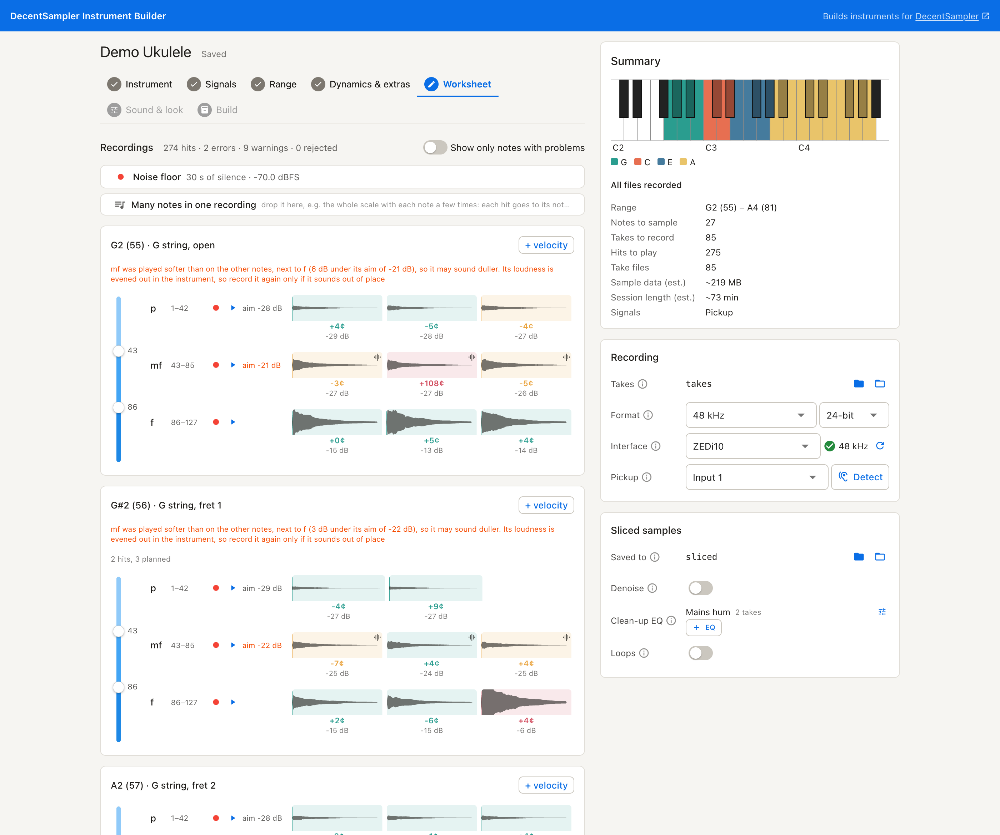

# Virtual Instrument Creator

Turn your own recordings of an instrument into a playable [DecentSampler](https://www.decentsamples.com/product/decent-sampler-plugin/) instrument and SF2 soundfont: describe it, record each note in the app or bring files from your DAW, check the samples, and build.

Made for ukuleles, it works for any plucked or struck string instrument, pitched percussion (kalimba, metallophone), sustained instruments, drums and single sounds.



## What it does

### Recording and organising takes

- **A recording plan:** from the type, strings and tuning (or a note range), velocities and variations, the builder lists every take to record and names its files.
- **Record in the app** at your own pace: the hits are found however they're spaced; interface dropouts are caught before they become clicks. Or drop in files from your DAW, or import a folder of cut samples (notes from the file names or the measured pitch).
- **A whole scale in one recording:** record or drop it in and each hit goes to its note by its pitch.
- **Several signals per note**, e.g. pickup and microphone, cut at the same points so they stay in phase, to blend, switch or layer.
- **Takes are cut into hits automatically**, each starting at the pluck. Move cuts by hand, move a recording to the right note, or edit it in your audio editor: your decisions are kept.
- **Extras:** release noises, chucks (down and up strokes, stopping ringing notes) and body knocks.

### Checking

- Each hit shows its tuning and attack loudness. Wrong notes, clipping, missing pitch, cut-off hits and hits that fit another velocity better are flagged, as are uneven variations and weak loops.
- **An aim for each velocity** tells you how loud to play the soft ones, so each velocity sounds alike on every note.
- Play a row's hits one after another, then reject, replace or move them. A filter shows only the notes with problems.


### Cleaning up noise

- **Denoising** (optional), with your noise-floor recording as the profile.
- **Clean-up EQ** for chosen takes: mains hum (50 or 60 Hz with harmonics, found in your noise floor), buzz or a click's ring.

### Even loudness

- **Level:** quiet recordings are raised as far as the note needs, with a limiter on the pluck's click.
- **Even out loudness:** notes or whole strings that came out louder or softer are brought in line, keeping the trend from low to high.
- **Loudness follows velocity:** one curve for all notes, so the next velocity changes the sound, not the loudness. Two or three recorded dynamics, e.g. p and mf, can reach from pianissimo to fortissimo.

### Sound

- **Tuning correction:** off, partial or full.
- **Mapping:** keys between and beyond the recorded notes are stretched from their neighbours; neighbour round robins add variation.
- **Pitch-relative low cut:** a key-tracked low cut that lowers what lies below each note's pitch, e.g. a ukulele body's boom, without cutting into the low notes. A knob blends it in.
- **Equalizer:** up to 8 bands over the spectrum of your samples, to listen to in the builder; each boost or cut becomes a knob.
- **Reverb without the pluck's hiss:** convolution reverbs on send buses per pitch band, from DecentSampler's reverb or your own impulse response.
- **More knobs:** signal mix, tone, attack, release, chorus, release-noise volume.
- **Loops** for sustained sounds, from markers in the files or found automatically.


### Look and packaging

- Background image, colours, credits and a library cover, with a preview as DecentSampler shows it.
- **DecentSampler:** a checked `.dsbundle`, installed into your library or packaged as a `.dslibrary` to share.
- **SF2 soundfont** for MuseScore and other players, with the same levels, velocity curve, low cut and EQ; copied straight into MuseScore's soundfont folder.

## What you need

- A Mac (the launcher is macOS only; the builder runs anywhere Python does)
- [uv](https://docs.astral.sh/uv/getting-started/installation/), which installs everything else
- [DecentSampler](https://www.decentsamples.com/product/decent-sampler-plugin/), to play the result
- An audio interface or microphone, if you record in the app

## Install

```bash
git clone https://github.com/paulwellnerbou/virtual-instruments.git
```

```bash
cd virtual-instruments
```

```bash
uv run vinst install-app
```

This puts **Virtual Instrument Creator.app** into `~/Applications`. It opens the builder in your browser and stops a couple of minutes after you close the page.

**In its own window:** open the builder once in Chrome and install it as an app (⋮ → Cast, save and share → Install page as app). The launcher then opens that window; always start it through the launcher.

## How it works

Seven steps, saved as you go:

1. **Instrument:** name and type, which sets the defaults for the rest; or import existing samples.
2. **Signals:** e.g. a pickup, a microphone or both.
3. **Range:** strings, tuning and frets, or the lowest and highest note.
4. **Dynamics & extras:** velocities, variations and extras.
5. **Worksheet:** ● on a velocity row records it, or drop a file onto the row. Click a hit to review it; drag the dots on a note's slider to give it velocities of its own.
6. **Sound & look:** tuning, loudness, equalizer, knobs, effects and artwork.
7. **Build:** check, install and package.

Your recordings go to a folder of your choice (`~/Music/DecentSampler Recordings/<instrument>` to start) and are never changed; deleting them, one or all, moves them to the Trash. Installing puts the instrument into `~/DecentSampler`, replacing only ones the builder made.

### Tips

- Record the noise floor first (30 s of silence): it tells the builder what is noise.
- Record a few more hits than you need and reject the weak ones.
- Try the first few notes before recording everything: build, play them, carry on.

More: the [user guide](docs/builder-ui.md), [recording an impulse response](docs/recording-impulse-responses.md), and [development](docs/development.md).

## Licence

MIT, see [LICENSE](LICENSE). The DecentSampler schema and engine vocabulary in `src/vinst/vendor/decentsampler_schema/` come from [DecentSamples/DecentSampler-schema](https://github.com/DecentSamples/DecentSampler-schema), MIT-licensed by their authors.
