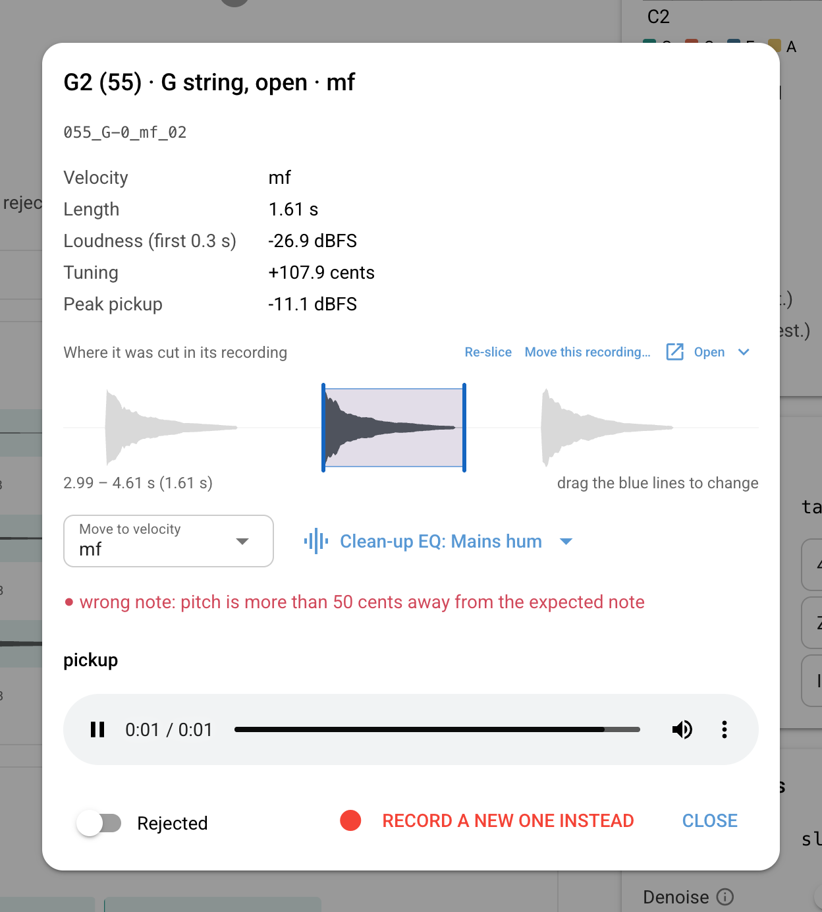

# DecentSampler Instrument Builder

Turn your own recordings of an instrument into a playable [DecentSampler](https://www.decentsamples.com/product/decent-sampler-plugin/) instrument. You describe the instrument, record each note in the app (or bring files from your DAW), check the samples, and the builder writes a ready-to-load `.dsbundle`.

It was made for ukuleles, but works for any plucked or struck string instrument, pitched percussion (kalimba, metallophone), sustained instruments, drums and single sounds.


## What you need

- A Mac (the app launcher is macOS only; the builder itself runs anywhere Python does)
- [uv](https://docs.astral.sh/uv/getting-started/installation/), which installs everything else
- [DecentSampler](https://www.decentsamples.com/product/decent-sampler-plugin/), to play the result
- An audio interface or microphone, if you record in the app

## Install

```bash
git clone https://github.com/paulwellnerbou/virtual-instruments.git
```

```bash
cd virtual-instruments
```

```bash
uv run vinst install-app
```

This puts **DecentSampler Instrument Builder.app** into `~/Applications`. Start it from the Dock, Spotlight or Finder: it opens the builder in your browser. It stops by itself a couple of minutes after you close the page.

**In its own window:** open the builder once in Chrome and install it as an app (⋮ → Cast, save and share → Install page as app). From then on the launcher opens that window. Always start it through the launcher.

## How it works

The builder walks you through seven steps. Everything is saved as you go, so you can stop and come back any time.

1. **Instrument:** name and type. The type fills in sensible defaults for everything after it. You can also choose to import a folder of existing samples instead of recording.
2. **Signals:** what you record, e.g. a pickup, a microphone or both. Each one becomes a sound you can blend or switch in the instrument.
3. **Range:** for string instruments the strings, their tuning and how many frets; otherwise the lowest and highest note.
4. **Dynamics & extras:** the velocities to record (e.g. soft and loud), how many variations of each note, and extra sounds such as release noise, a muted strum or a body knock.
5. **Worksheet:** record, check and fix every note (see below).
6. **Sound & look:** tuning correction, an equalizer, knobs, effects, colours and a background image.
7. **Build:** creates the instrument, checks it, installs it into DecentSampler and can package it as a `.dslibrary` to share.

### Recording and checking in the worksheet

- **Record in the app:** press ● on a velocity row. After a count-in, a visual metronome tells you when to play each hit. Choose your audio interface and its input in the Recording panel beside the notes; "Detect" finds the input you play into.
- **Or use your DAW:** record wherever you like and drop the audio file (WAV, AIFF, FLAC) onto the right row.
- **Every hit is cut and analysed for you:** you see its waveform, how far it is out of tune and how loud its attack is. Wrong notes, clipping and hits that belong to another velocity are flagged.
- **Listen and compare:** ▶ plays the hits of a row one after another, so you can pick the best ones.
- **Fix what's wrong:** click a hit to review it. You can reject it, record a new one instead, move it to another velocity (or drag it there), or drag the blue lines to change where it was cut.
- **Clean up noise:** a clean-up EQ takes hum, buzz or a click's ring out of the recordings you pick; only the samples change, never your recordings. Hits it went through show a small EQ mark.
- **Per-note velocities:** drag the dots on the slider beside a note to set where the next velocity starts, or add a velocity to just that note.



### Shaping the sound

The **Equalizer** in Sound & look draws its bands as a curve over the spectrum of your samples. Drag a point to shape it, scroll on it for its width, and **Listen** to a few notes through it. In the instrument, each band you boost or cut gets a knob of its own.


### Where your files go

- Your recordings go to a folder of your choice (by default `~/Music/DecentSampler Recordings/<instrument>`). The builder never changes them.
- The finished instrument is installed into your DecentSampler library folder (`~/DecentSampler`). The builder only ever replaces instruments it created itself.

### Tips

- Record the noise floor first (30 s of silence): it tells the builder what is noise and what is your instrument.
- Record a few more hits than you need and reject the weak ones; the builder keeps your decisions when you slice again.
- You can try the first few notes before recording everything: build, play them in DecentSampler, then carry on.

More detail on every step is in [docs/builder-ui.md](docs/builder-ui.md). For working on the builder itself, see [docs/development.md](docs/development.md).

## Licence

MIT, see [LICENSE](LICENSE). The DecentSampler schema and engine vocabulary in
`src/vinst/vendor/decentsampler_schema/` come from
[DecentSamples/DecentSampler-schema](https://github.com/DecentSamples/DecentSampler-schema) and are MIT-licensed by their authors
(see the LICENSE file there).
