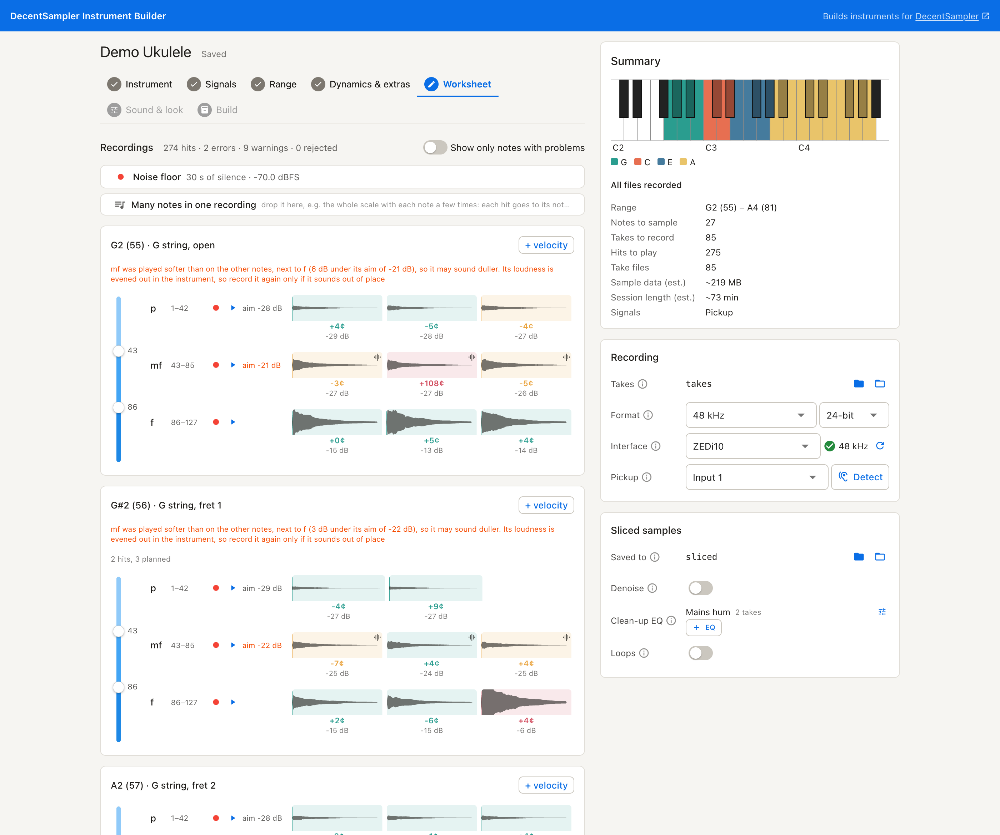
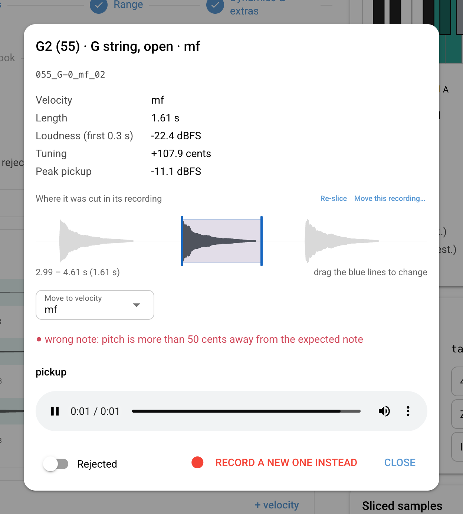
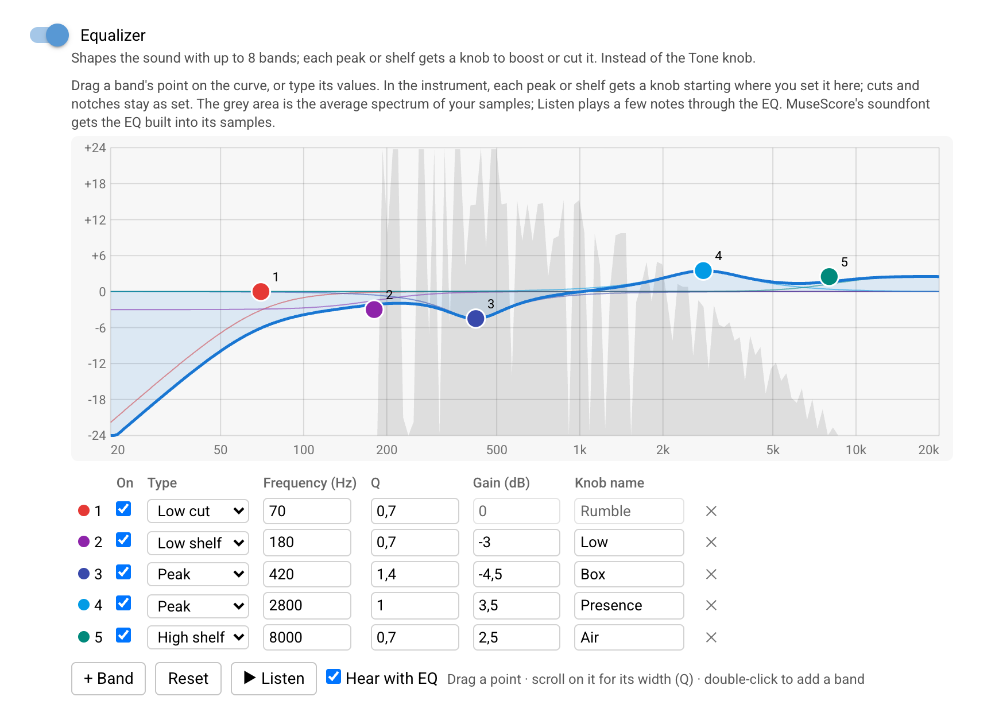

# User guide

Seven steps, from describing your instrument to a finished DecentSampler instrument, saved as you go.

The start page creates, opens, **duplicates** and **deletes** instruments. Duplicate for the next instrument of the same kind, e.g. a second ukulele. Delete moves its settings, review decisions and builds to the Trash; recordings, sliced samples and the installed copy stay.

## 1. Instrument

Name, subtitle (shown under the name, e.g. "Hawaiian koa"), author, version, website, copyright (starts as "© <year> <author>"), description, and the **type**, which sets the defaults for the rest:

| Type | Examples | Defaults |
|---|---|---|
| Plucked / struck string | ukulele, harp, mandolin | strings and tuning, 3 velocities, 4 variations, release noise |
| Pitched percussion | metallophone, sansula, kalimba | 3 velocities, 3 variations |
| Sustained | violin, clarinet, flute, pads | looped notes, attack and release knobs, 1–2 velocities |
| Unpitched percussion | body knocks, drums | one sound per key, many variations |
| Single sample | a found sound | one sample across a key range |

Under **Samples**, record new takes or [import existing samples](#importing-existing-samples).

## 2. Signals

What you record, e.g. a pickup, a microphone or a DI; each becomes its own sound.

- **Together:** recorded at the same time as the other "together" signals, e.g. pickup and mic on two inputs. Cut at the same points; a knob blends them.
- **Own pass:** a separate run through all notes, e.g. a piezo and an internal mic sharing one output. Passes **switch** via a menu or **layer** (play together, like two players in unison); set in step 6.

## 3. Range

- **String instruments:** strings, tuning and frets, e.g. G C E A, re-entrant or low G. Each note is recorded on the string where it's played at the lowest fret.
- **Everything else:** lowest and highest note.
- **Sampling density:** every note, every 2nd or every 3rd; the notes between are stretched from their neighbours.
- **Beyond the recorded notes:** stretch the lowest and highest samples further. Only the build changes; more than 2–3 semitones starts to sound unnatural.

Note names follow DecentSampler: middle C is C3 (MIDI 60).

## 4. Dynamics and extras

- **Velocities:** the dynamics every note is recorded at, quietest first, e.g. p and f, each in its own take. A slider sets where each starts ("f starts at velocity 80").
- **Variations per velocity:** hits of each note and velocity; DecentSampler alternates them so repeats don't sound mechanical.
- Both are **defaults**: a note can get its own velocities in the worksheet.
- The instrument sets **loudness by velocity** itself (step 6), so velocities only need to *sound* different. Two or three dynamics you can play evenly, e.g. p and mf, are enough, even for pianissimo to fortissimo.
- How long each hit rings, the noise-floor length, and **extras**: release noises, chucks, body knocks, each one take.

## 5. Worksheet

Record, check and fix everything in one place.

**Beside the notes:** the takes folder, sample rate and bit depth, your audio interface and each signal's input ("Detect" finds it while you play), and the samples folder, with optional denoising, clean-up EQs and loops.

**The noise floor** comes first: 30 s of silence that tells the builder what is noise. Below it, a card per note and a row per **extra**.

### Recording

- **● on a row** records it: a count-in, then one hit per bar to a visual metronome. Set how many hits first.
- Once a velocity is recorded, ● records **more hits** beside the others, to compare and reject the weak ones. The noise floor and extras are single takes, so ● records them again.
- A recording replaces the old one only when it finishes: cancelling or an interface problem keeps what you had. The app won't record while the interface runs at another sample rate than the instrument.
- **Recorded elsewhere?** Drop a WAV, AIFF or FLAC onto a row. It becomes that velocity's take, or more hits if there is one, so nothing is overwritten. With several signals per take, put the signal's name in the file name (`…_piezo.wav`).
- **Many notes in one recording?** Drop it onto **Many notes in one recording**, e.g. the whole scale with each note played a few times. Each hit's note comes from its pitch; hits in a row on one note become that note's take at the velocity you choose, or more hits if it has one. Before anything is written, a list shows where each note goes; notes outside the range are left out. A single misread or wrong note inside a run of the same note stays with it, flagged if it's wrong. With several signals, drop one file per signal together.
- Takes are named `<note>_<velocity>_<signal>.wav`, e.g. `060_C-0_p_pickup.wav`; later hits `…_p-more1_pickup.wav`. Files you put in the folder yourself are picked up with **Slice them**.

### Checking

- Each recording is **cut into hits** at once. A row shows them side by side, as wide as they are long, each with its **tuning** and **attack loudness**.
- **Flags:** wrong note (over 50 cents off), clipped, no pitch, cut off, out of tune (over 20 cents; information only, as the instrument corrects tuning), and loudness fitting another velocity better. A note whose velocities don't get louder in order is reported too.

### How loud to play each velocity

- Play the **loudest velocity** with peaks around −6 dBFS (the recording panel tells you if it's far below). Keep the input gain the same for the whole instrument.
- Each **softer velocity** has an **aim**, e.g. "aim −37 dB": the attack loudness that puts it as far below the note's loudest as on the other notes. It's the typical dB per velocity between the middles of two velocities in your recordings, so a note with its own split or a third velocity gets a matching aim. Until three notes have two velocities, a default is used (0.2 dB per velocity, 13 dB for a split at 81). The recording panel shows it before you record.
- Within **±3 dB** of the aim is fine. Further off, the hit is flagged, the aim turns orange, and the note explains, e.g. "piano was played harder than on the other notes, next to forte (4 dB over its aim of −35 dB), so it may sound brighter. Its loudness is evened out in the instrument, so record it again only if it sounds out of place." Compare it with the same velocity on the neighbouring notes: a piano played almost forte sounds like one however loud it plays. With loudness following velocity off, the note says instead that the step to the louder velocity differs from the other notes.
- **Variations** should be within about ±1.5 dB of each other. One more than 3 dB off is flagged for information; Even out loudness brings it closer.
- **▶** plays a row's kept hits one after another, attacks 0.75 s apart.
- **Show only notes with problems** hides the rest.

### Fixing

Click a hit to open it:

- **Rejected** leaves it out. **Record a new one instead** records one more hit and rejects this one once it's saved.
- **Move to velocity**, or drag the hit onto another row of the same note.
- **Drag the blue lines** to set where the hit starts and ends. A start up to 150 ms before the pluck snaps to just before it; inside a ringing note it stays where you put it. On sustained instruments it only skips the silence, so a slow attack keeps its rise. Your cuts are kept when slicing again; "Find hits automatically" goes back.
- **Re-slice** finds this recording's hits again.
- **Move this recording…** moves a take played on the wrong note to the right note and velocity.
- **Open** opens the recording in macOS's default app for WAV; the arrow beside it lists the others, e.g. your audio editor to take out a click. Edit the recording, not the samples, which slicing writes anew. An edit that keeps the length (an EQ, a click taken out) moves no hit: once saved, the worksheet recuts it where it was within seconds, keeping your decisions, click grid and cuts, and an open hit dialog plays the new sound. Building does the same. A longer or shorter recording, or another performance, is sliced anew.
- A recording without a hit shows a **no hit found** tile; open it to mark the hit by hand.

Decisions are kept when you slice again, as long as the recording hasn't changed. Recordings added, changed or deleted since slicing are listed, and the build waits until they're sliced. After an update that finds hits better, the worksheet suggests slicing again, keeping your decisions and cuts.

### Velocities per note

- Drag the dots on a note's slider to set where its next velocity starts.
- **+ velocity** adds one to this note only, e.g. an ff for the low strings; × removes an empty one; **Use default velocities** goes back to step 4's.
- Hits of a removed velocity wait under "No velocity" until you drag them into one.

### Loops

For sustained sounds (on by default for sustained and single-sample instruments): notes play on while the key is held. Loop markers in the file (e.g. from WaveLab) are used as they are; otherwise the builder finds a loop. Weak loops are flagged; the hit dialog plays the loop, and "Use loop" turns it off for one hit.

### Clean-up EQ

Takes a noise out of chosen recordings completely: mains hum or buzz on a pickup, a click's ring. Only the samples change, never the takes.

- **+ EQ** beside Denoise makes one. **Mains hum, 50 Hz** (Europe and most of the world) or **60 Hz** (the Americas, parts of Asia) makes a ready one for every take: Hum + harmonics at that frequency. If your noise floor has hum, the menu marks its frequency "in your noise floor" and the EQ is only for the signals it was heard on. The dialog's **+ Filter** offers the same two.
- **Empty EQ** is one to fill yourself: a name, its signals (none chosen: all), and filters: peak, notch, low and high shelf, highpass, lowpass, and **Hum + harmonics**, which cuts a frequency and its multiples.
- An EQ is for **the takes you pick** or **every take**. Pick it in a hit's dialog under **Clean-up EQ**: ticking one slices the recording again and reopens the same hit, so you can listen.
- Hits through a clean-up EQ show a small EQ mark on their waveform; hover to see which.
- After changing an EQ, the worksheet lists the takes using it; **Slice them** applies it, and the build waits until then. Decisions and cuts are kept: hits are found in the takes as recorded, so an EQ never moves a cut.
- Tuning and loudness are measured after the EQ, as that's what plays; peaks count the take too, so a clipped take is still flagged. Filters run forwards and backwards, so nothing moves in time; a notch can also lower a nearby overtone of the note.
- Moving a recording takes its EQs along; deleting one forgets its EQs, so a new recording under its name starts without.
- The editor warns about a filter above what the sample rate can hold (left out) and an EQ for a removed signal (skipped).

## Importing existing samples

**Import existing samples** in step 1 builds from a folder of cut samples, one note per file (WAV, AIFF, FLAC, subfolders included). Step 3 isn't needed; step 4 only gives the velocity names. The folder is only read; files are copied into the instrument.

- **Notes** come from the file name, as a note name ("C3", "F#4", "Eb2") or MIDI number ("055"), checked against the measured pitch, which also tells whether middle C is C3 or C4. Files without a usable name get their note from the pitch; names that disagree are flagged; files without a note are listed as "Not imported".
- **Velocities** come from a velocity name ("_mf_"), else a number ("v2"), else by loudness within each note. Several samples for one velocity become variations, ordered by "rr" or "take" numbers or file name.
- **Signals:** files named with a signal ("_piezo", "_mic") are paired into one hit.

The worksheet then works as for recorded takes. Change the folder and it asks you to import again.

## 6. Sound and look

Only the built instrument changes here, not your recordings or samples.

- **Tuning correction:** off, partial (keeps some natural detune) or full.
- **Mapping:** keys between recorded notes play the note above, pitched down, which sounds more natural than up; unrecorded or unusable notes are covered the same way. **Neighbour round robins** also cycle each key through nearby notes' hits: up to 1 or 2 semitones below (pitched up) and above (pitched down), each set on its own.
- **Even out loudness** (optional): draws each velocity's loudness over the keyboard as a straight line and keeps every sample within the allowed difference of it (±3 dB to start); samples further off are brought back to it. The line is the median slope between every two notes (flat below three notes), so a trend from low to high keeps its shape, while a single note or a whole string that's louder or softer (common with piezos) is brought in without tilting it. Soft velocities stay softer than loud ones. A sample needing more than 18 dB gets 18 dB and is named in the build's warnings: likely a mis-hit or slicing error.
- **Level:** the build makes the instrument as loud as it needs to be, without clipping.
- **Extras:** play on key release, on their own key, or not at all. On their own key, each press plays the next hit in recorded order (e.g. chucks down, up, down…). **Stops ringing notes** (on for a chuck) fades out ringing notes, like a hand on the strings. **Down and up on keys of their own:** for hits alternating down and up, odd hits play on the down key and even ones on the up key, while the extra's own key plays them all. This goes by place in the recording, so rejecting a hit doesn't swap the rest, but a missed or split chuck does. In the soundfont each key plays one hit.
- **Loudness follows velocity** (on to start): loudness rises by the dB set from velocity 1 to 127 (42 dB to start), quickly at the soft end and gently at the top, so pianissimo stays while 60 to 100 changes by only about 4 dB. At 42 dB, volume is proportional to velocity: 100 is 2 dB softer than 127, 64 is 6 dB, 40 is 10 dB, 20 is 16 dB. Every velocity's samples are moved onto that curve, so the next velocity changes the sound, not the loudness: piano at 80 and forte at 81 are about as loud, and the curve can reach further than you played. A note's loudest velocity plays as recorded in the middle of its range, the softer ones follow it, and variations keep up to half of Even out loudness's allowed difference between them (all of it when that's off). 42 dB is DecentSampler's own velocity response at full strength; other values are written as a few slices per velocity range, each within a quarter dB of the curve. The soundfont plays the same curve. Off, samples play as recorded and velocity changes their volume only a little (velocity sensitivity, under Envelope), so velocities jump by however far apart they were recorded.
- **Envelope:** attack, release and velocity sensitivity, also where the Attack and Release knobs start. With loudness following velocity, velocity sensitivity only applies to extras.
- **Controls:** the instrument's knobs, each with a switch: signal mix, tone or equalizer, pitch-relative low cut, attack, release, reverb, chorus, release-noise volume. Each says what it does, and its settings open beside it; only controls that can do something are listed. Attack isn't for plucked or struck strings: fading in only softens the pluck. The mod wheel drives the tone knob (without it, the first other knob, never the low cut or an EQ band).
  - **Reverb** has a room size and damping, how fast the tail loses its highs; more is warmer and keeps a pluck's click from ringing on as hiss.
  - **Without the attack's hiss** (off to start, for plucked and struck strings) goes further: the dry sound stays as recorded, and the reverb gets neither the click's highs nor much of each note from about three times its pitch up. Each sample also goes to a bus for its few semitones, holding a convolution reverb made from DecentSampler's (same room and damping) with a high shelf for that pitch. The Reverb knob sets the buses' volume, so the same setting sounds a little quieter, without the highs. Notes without a click (bowed, blown, sung) gain little. The build says how many reverbs it made; the soundfont has no reverb. Off, the instrument is built as without the switch.
  - **Impulse response of your own** (optional, under that switch): a room or reverb you captured instead of DecentSampler's (WAV, AIFF or FLAC, copied into the instrument's folder), filtered the same way and as loud as DecentSampler's reverb at the room size and damping set. Remove its direct sound first, or every note plays twice. See [Recording your own impulse response](recording-impulse-responses.md).
- **Pitch-relative low cut:** lowers what lies below each note's pitch (a key-tracked low cut), e.g. a ukulele body's low resonance after the pluck: by the dB set, below the share of the pitch set, as a steep curve drawn beside its settings. It follows each note, so it never cuts into low notes, and leaves extras and unpitched sounds alone. Its knob, **Low cut %**, blends from as recorded (0 %) to fully cut (100 %, where it starts); for that, the instrument carries what the cut took out as extra samples playing along. Applied when building, so no slicing again. Loudness is evened out for the full cut, so notes with much resonance play louder with the knob down. The soundfont always has the full cut.
- **Equalizer** (instead of the tone knob): up to 8 bands (low and high shelf, peak, low and high cut, notch) drawn over the average spectrum of your samples. Drag a point for frequency and gain, scroll for width (Q), double-click to add a band, or type values in the table. **Listen** plays a few notes low to high through it; **Hear with EQ** toggles it to compare. Each peak and shelf gets a knob, starting where you set it; cuts and notches stay fixed. Evening out and level count the EQ at its knobs' start. Boosts run after the level, so if they'd clip, the instrument plays that much quieter and the build says by how much. The soundfont gets the EQ built into its samples.

- **Look:** a background image (812 × 375 px, PNG or JPG; drop it or click +, copied into the instrument's folder), and background, text and accent colours (the accent lights the knob arcs and tints playable keys). The subtitle shows under the title, and "by <author> · v<version> · <copyright> · <website>" at the bottom right, without "by <author>" when the copyright names them; each of the four can be switched off. All of them, the subtitle and description still go into the preset's comment and the soundfont's info. The preview shows the instrument as in DecentSampler's smallest window: knobs at their start, playable and extra keys tinted.
- **Library cover:** a square PNG or JPG, dropped or added with **+**, copied into the instrument's folder and shown uncropped so you can see it's square. DecentSampler's File Browser shows it; **Remove cover** clears it.

## 7. Build

**Build** creates the instrument and checks the preset format, sample and artwork files, key and velocity coverage, and variations, listing warnings and errors. You can build before everything is recorded, e.g. to try the first notes.

- **DecentSampler:** **Install into DecentSampler** copies it into `~/DecentSampler`, replacing only instruments this builder made. **Package .dslibrary** makes one file to share. **Show in Finder** shows it.
- **Soundfont:** the same instrument as SF2, for MuseScore and other players. SF2 has no variations, so each key and velocity plays one sample (its own note's, best in tune), without release noises; the Equalizer is built into its samples. **Download** saves it; **Copy to MuseScore** puts it into `~/Documents/MuseScore4/SoundFonts` (never over one made elsewhere): restart MuseScore and choose it in the Mixer. **Show in Finder** shows the file.
